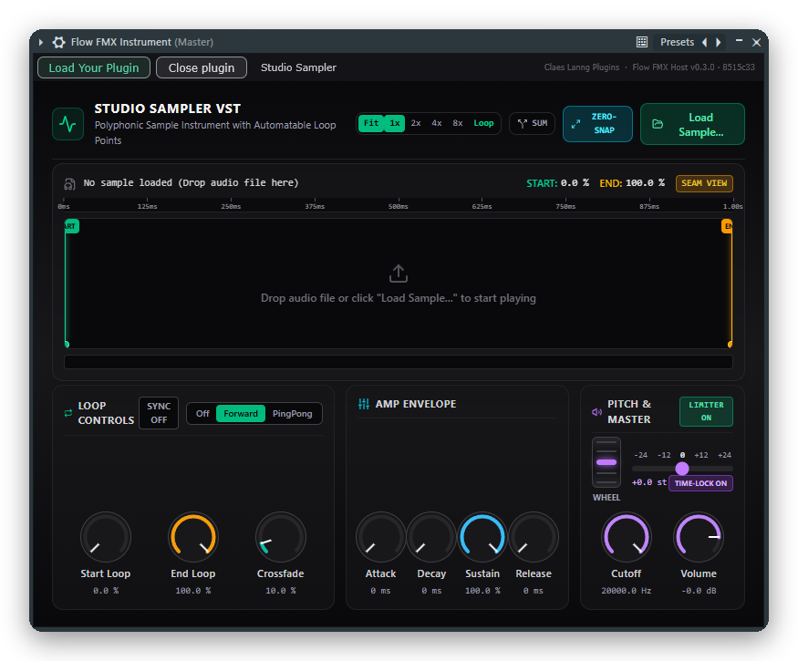
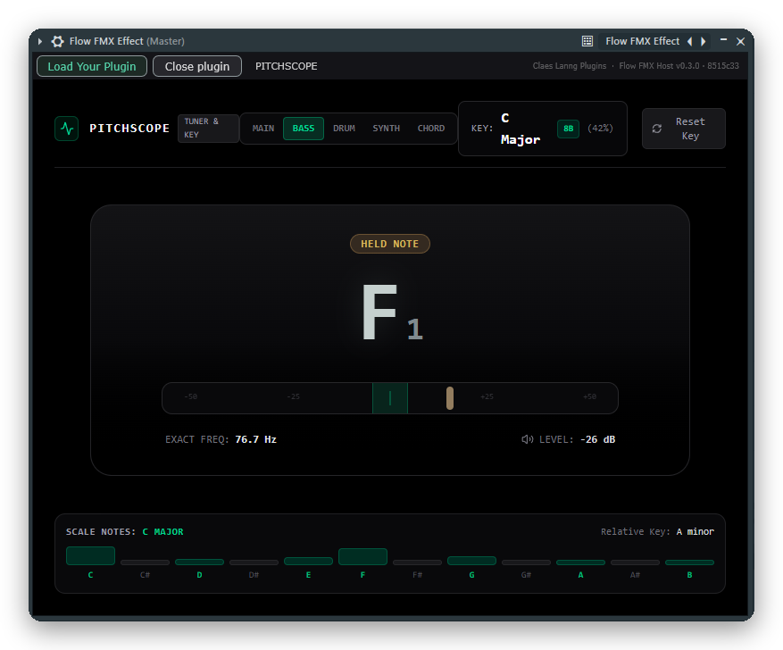
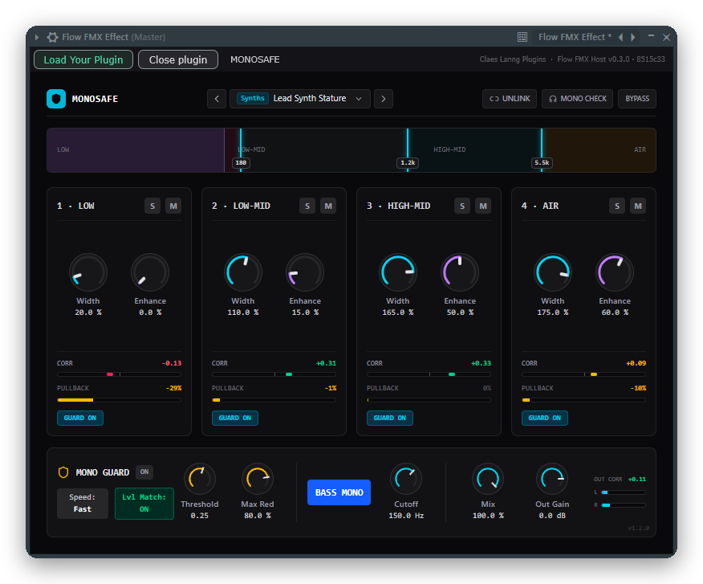
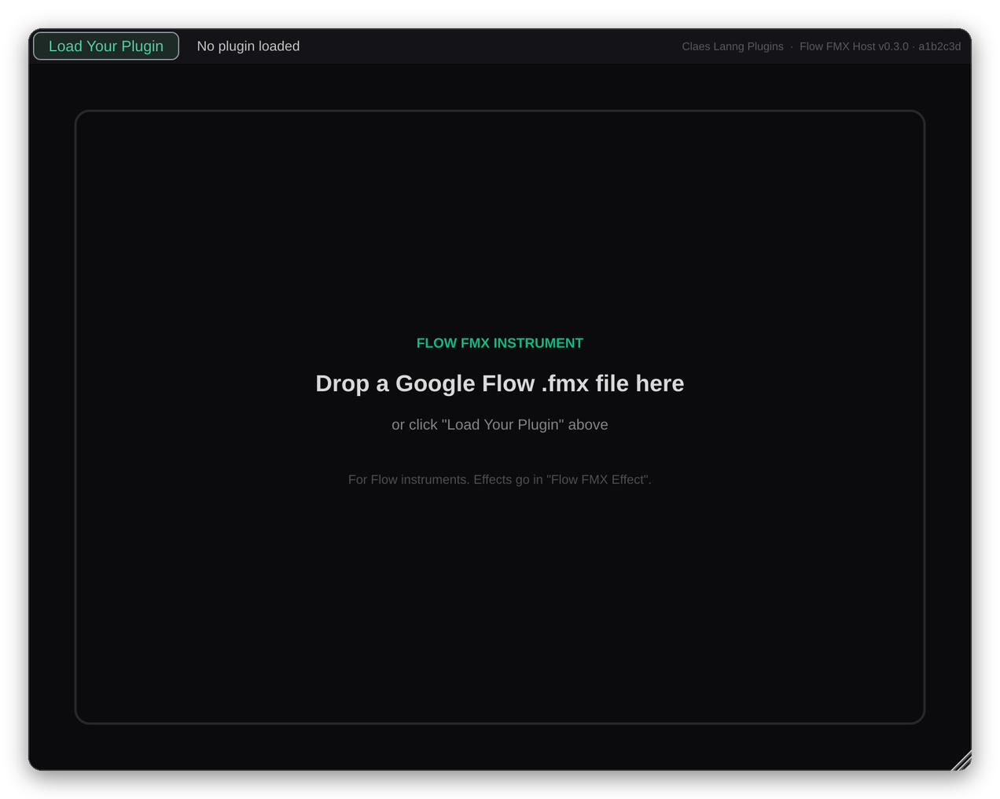
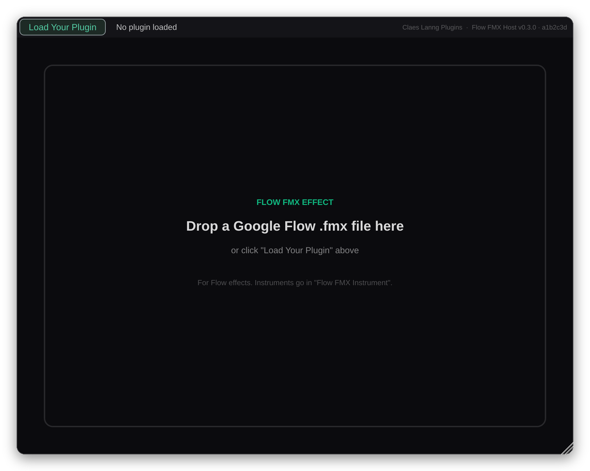

<div align="center">

# Flow FMX Host

**Use plugins made with Google Flow Music in FL Studio and other Windows DAWs.**

by **Claes Lanng Plugins**

[](https://github.com/claeslanng/flow-fmx-host/actions/workflows/build.yml)


[**⬇ Download the latest version**](https://github.com/claeslanng/flow-fmx-host/releases/latest) · [Examples](#example-plugins) · [Install guide](#installation) · [How it works](#how-it-works)

</div>

---

## What it does

Google Flow Music lets you build your own instruments and effects and export them as
`.fmx` files, but its plugin only runs on macOS. **Flow FMX Host** is a VST3 plugin for
Windows that opens those `.fmx` files, so your Flow creations run inside your DAW.

It comes as two plugins:

| Plugin | Use it for | Shows up in FL Studio as |
|---|---|---|
| **Flow FMX Instrument** | Flow instruments (synths, samplers) | Generator |
| **Flow FMX Effect** | Flow effects | Effect |

## Features

- 🎛️ **The plugin's own interface.** Each `.fmx` shows the UI it was designed with, exactly as in Flow.
- 🔊 **Runs the original sound engine.** No re-creation or approximation.
- 🎚️ **Full automation.** Every control appears by name in your DAW (Volume, Cutoff, Attack, …).
- 💾 **Saved with your project.** The `.fmx` is stored inside the project, so it opens even if the file moves.
- 📂 **Drag & drop.** Drop audio samples onto the plugin, or drop an `.fmx` anywhere on the window to load it.
- ↔️ **Resizable.** The interface scales smoothly to any window size, and the size is remembered.
- 🎹 **Sample-accurate MIDI.** Notes are timed to the exact sample.
- 🔁 **Swap plugins any time.** Use **Load Your Plugin** and **Close plugin** in the top bar.

## Example plugins

> **These are examples.** The plugins below are `.fmx` plugins made by Claes Lanng Plugins in
> Google Flow Music, shown running inside Flow FMX Host in FL Studio. They are **not included**
> with the download; Flow FMX Host loads the `.fmx` files you create yourself.

<div align="center">

<br>
<sub><b>Example: Studio Sampler</b> · instrument · polyphonic sampler with loop points, envelope, filter and pitch wheel, in <i>Flow FMX Instrument</i></sub>

</div>

<br>

<table>
  <tr>
    <td align="center" width="50%">
      <br>
      <sub><b>Example: PitchScope</b> · effect · tuner and key detector, in <i>Flow FMX Effect</i></sub>
    </td>
    <td align="center" width="50%">
      <br>
      <sub><b>Example: MonoSafe</b> · effect · four-band stereo width and mono-compatibility tool, in <i>Flow FMX Effect</i></sub>
    </td>
  </tr>
</table>

## The host

<table>
  <tr>
    <td align="center" width="50%">
      <br>
      <sub><b>Flow FMX Instrument</b>: start screen</sub>
    </td>
    <td align="center" width="50%">
      <br>
      <sub><b>Flow FMX Effect</b>: start screen</sub>
    </td>
  </tr>
</table>

## Installation

1. **Download** `FlowFMX-Windows-x64.zip` from the [latest release](https://github.com/claeslanng/flow-fmx-host/releases/latest) and unzip it.
2. **Copy** both `.vst3` folders into:
   ```
   C:\Program Files\Common Files\VST3
   ```
3. **Scan** in FL Studio: *Options → Manage plugins → Find more plugins*.
4. **Add** *Flow FMX Instrument* to the Channel Rack (or *Flow FMX Effect* to a mixer slot).
5. Click **Load Your Plugin** and choose your `.fmx` file, or drag the file onto the window.

> **Updating?** Close FL Studio, copy the new `.vst3` folders over the old ones (choose *Replace*),
> and reopen FL Studio. Your projects keep working.

### Requirements

- Windows 10 or 11, 64-bit
- A VST3 host (developed and tested with FL Studio)
- Microsoft Edge WebView2 Runtime. This is preinstalled on almost every Windows 10/11 PC; if the
  plugin window stays blank, install the [Evergreen WebView2 Runtime](https://developer.microsoft.com/microsoft-edge/webview2/).

## Good to know

- The version and build number appear in the top-right corner of the plugin window. Include them when you report a problem.
- Audio samples you load inside a Flow plugin are saved by file path, so keep them where they are.
- **Close plugin** clears the loaded plugin and its settings for that instance.

## How it works

An `.fmx` file is a small package with three parts:

| Part | What it is | How the host runs it |
|---|---|---|
| Sound engine | WebAssembly module | Executed by the embedded [wasm3](https://github.com/wasm3/wasm3) runtime on the audio thread |
| Interface | Web page (HTML/React) | Shown with Microsoft WebView2, connected to the host through a small bridge |
| Parameters | Names, ranges, units | Published to the DAW as automatable parameters |

<details>
<summary><b>Technical details</b></summary>

<br>

- Built with [JUCE 8](https://juce.com) (C++17), compiled with clang-cl for x64.
- `src/WasmDsp.*`: runs the DSP module (Flow plugin ABI v1: `init`, `noteOn`/`noteOff`,
  `process`, parameter memory at offset 65536, host imports for state and audio files).
- `src/PluginEditor.cpp`: hosts the UI in WebView2 and emulates the messages the Flow UI
  expects (`IPlugSendMsg`, `SPVFD`, `__vstOn*`), scales the UI to the window, and handles drag & drop.
- `src/PluginProcessor.*`: 64 fixed parameter slots, MIDI, transport, and state saved in the DAW project.
- `cmake/PatchJuce.cmake`: a small patch that lets WebView2 pass dropped files' paths to the plugin.

**Building from source** (Visual Studio 2022 with the *C++ Clang tools* component):

```bat
nuget install Microsoft.Web.WebView2 -OutputDirectory C:\nuget
cmake -S . -B build -G "Visual Studio 17 2022" -A x64 -T ClangCL -DJUCE_WEBVIEW2_PACKAGE_LOCATION=C:/nuget
cmake --build build --config Release
```

Every push to `main` is built and tested on Windows by GitHub Actions
(`.github/workflows/build.yml`). The test loads a real `.fmx`, plays notes, checks the parameters,
and saves and restores the state. Each passing build is published as the latest release.

</details>

## Credits

- Developed by **Claes Lanng Plugins**
- Built on [JUCE](https://juce.com) and [wasm3](https://github.com/wasm3/wasm3)

<sub>Flow FMX Host is an independent project and is not affiliated with, endorsed by, or connected to Google.
Google and Flow are trademarks of Google LLC. JUCE is used under the AGPLv3 / JUCE licence.</sub>
